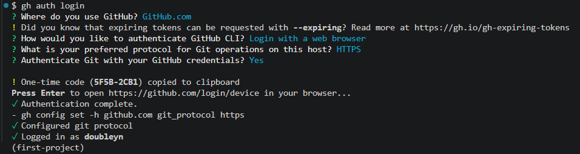

# 2026.11.02 TIL

## 학습 분야 : Python, VS Code
--
### 1. 오늘 배운 개념

핵심개념
- Git Hub CLI에 계정 연결하기 
```
![NOTE]
$ winget install --id GitHub.cli
$ gh --version
$ gh auto login
```

- 터미널에서 GitHub 다루기
```
$ gh repo list 

$ gh repo create kant_python --private
# ✓ Created repository doubleyn/kant_python on github.com
#   https://github.com/doubleyn/kant_python

git remote add origin https://github.com/doubleyn/kant_python
git remote -v

gh browse # GitHub 레포로 이동
```
주요 개념

---

- 가비지 컬렉터
- 파이썬에서는 거듭제곱이 `^` 가 아니고 `**`
- format과 f-string
- 자료구조 - 리스트, 튜플, 딕셔너리

## 📘 Chapter 01. 파이썬 시작하기 & 변수

### 실행 환경 확인

```python
import sys
print("hello world")
print(sys.executable)  # 현재 사용 중인 파이썬 인터프리터 경로 (.venv 확인용)
```

### 주피터 노트북 단축키 (명령 모드)

| 단축키 | 기능 |
| --- | --- |
| `A` | 위에 셀 추가 |
| `B` | 아래에 셀 추가 |
| `DD` | 해당 셀 삭제 |
| `M` | 마크다운 셀로 전환 |
| `Y` | 코드 셀로 전환 |

### 변수와 주석

```python
price = 1000
print(price)        # 1000
# 주석 : 실행되지 않는 영역, 소스코드의 설명
total = price * 5
print(total)        # 5000
```

### 변수 이름 규칙

| 규칙 | 잘못된 예 |
| --- | --- |
| 숫자로 시작 불가 | `1_name` ❌ |
| 공백 불가 | `user name` ❌ |
| 하이픈(`-`) 불가 | `user-age` ❌ |
| 예약어 사용 불가 | `if`, `def` ❌ |

### 표기법 (Naming Convention)

| 표기법 | 예시 | 비고 |
| --- | --- | --- |
| 스네이크 케이스 | `user_name`, `value_list` | ✅ 파이썬 변수·함수 컨벤션 |
| 파스칼 케이스 | `UserName`, `ValueList` | 클래스 이름에 주로 사용 |
| 카멜 케이스 (단봉낙타법) | `userName`, `valueList` |  |

### 기본 자료형

```python
age = 25                      # 정수 (int)
pi = 3.14                     # 실수 (float)
is_alive = True               # 불리언 (bool)
user_name = "YoonSooYoung"    # 문자열 (str)
grade_type = [1, 2, 3, 4]     # 리스트 (list)
```

### 변수 재할당

```python
age = 20  # 메모리에 20 객체를 생성, age는 그 메모리 주소를 기억
age = 25  # 메모리에 25 객체를 생성, age -> 25
print(age)
```

- 파이썬 변수는 **값을 담는 상자가 아니라 객체를 가리키는 이름표**
- 같은 변수에 다른 타입의 값도 재할당 가능 (동적 타이핑)

```python
x = 10
print(type(x))  # <class 'int'>
print(id(x))    # 메모리 주소

x = "hello"
print(type(x))  # <class 'str'>
print(id(x))    # 다른 메모리 주소
```

```python
money = 5000
money = money + 2000
print(money)  # 7000
```

> 💡 **Garbage Collector (가비지 컬렉터)**
더 이상 참조되지 않는 객체는 자동으로 메모리에서 해제된다. 개발자가 메모리 해제를 직접 신경 쓰지 않아도 된다.
> 

---

## 📗 Chapter 02. 연산자 & 문자열 포매팅

### 산술 연산자

| 연산자 | 의미 | 예시 | 결과 |
| --- | --- | --- | --- |
| `+` | 더하기 | `1 + 1` | `2` |
| `*` | 곱하기 | `10 * 2` | `20` |
| `/` | 나누기 (항상 float) | `10 / 2` | `5.0` |
| `%` | 나머지 | `10 % 3` | `1` |
| `//` | 몫 | `10 // 2` | `5` |
| `**` | 거듭제곱 | `10 ** 2` | `100` |

### 복합 대입 연산자

```python
score = 100
score += 50   # score = score + 50  → 150
score //= 3   # score = score // 3  → 50
print(score)  # 50
```

### 비교 연산자

```python
a = 10
print(a == 10)  # True
print(a != 10)  # False
print(a > 10)   # False
print(a < 10)   # False
print(a >= 10)  # True
print(a <= 10)  # True
```

문자열은 **사전순(유니코드 값)** 으로 비교된다.

```python
print("apple" > "banana")  # False
print(ord("a"))  # 97
print(ord("b"))  # 98
```

### 논리 연산자

| 연산자 | 의미 |
| --- | --- |
| `and` | 둘 다 True일 때 True |
| `or` | 하나라도 True면 True |
| `not` | 참/거짓 반전 |

```python
is_adult = True
has_ticket = False

print(is_adult and has_ticket)  # False
print(is_adult or has_ticket)   # True
print(not is_adult)             # False
```

> 💡 **단락 평가 (Short-circuit Evaluation)**
앞쪽 값만으로 결과가 확정되면 뒤쪽은 실행하지 않는다.
> 

```python
print(False and (10/0 > 1))  # False (ZeroDivisionError 발생 ❌)
print(True or (10/0 > 1))    # True  (ZeroDivisionError 발생 ❌)
# print(False or (10/0 > 1)) # ZeroDivisionError 발생 ⭕
```

### 연산 우선순위 (높은 순)

1. `*`
2. , `/`, `//`, `%` (같은 순위 → 왼쪽부터)
3. `+`,  (같은 순위 → 왼쪽부터)
4. 비교 연산자 `==`, `!=`, `>`, `<` …
5. `not` → `and` → `or`

```python
result = 10 + 2 * 5 > 25    # 20 > 25  → False
result = (10 + 2) * 5 > 25  # 60 > 25  → True
```

> 💡 헷갈릴 땐 괄호 `()` 로 명확하게!
> 

### 문자열 포매팅

**① % 포매팅**

```python
print("선발 출전: %s, %d" % ("손흥민", 20))   # 선발 출전: 손흥민, 20
print("선발 출전: [%5d]" % (20))              # 선발 출전: [   20]
print("소숫점 표기: %.2f" % (3.141592))       # 소숫점 표기: 3.14
```

| 서식 | 의미 |
| --- | --- |
| `%s` | 문자열 |
| `%d` | 정수 |
| `%f` | 실수 (`%.2f` → 소수점 2자리) |
| `%5d` | 5칸 확보 후 우측 정렬 |

**② format() 방식**

```python
name, price, qty = "Cake", 6500, 2
print("주문내역: {0} {1} -> 총 {2}원".format(name, qty, price * qty))
# 주문내역: Cake 2 -> 총 13000원
```

**③ f-string 방식 ✅ (권장)**

```python
print(f"주문내역: {name} {qty} -> 총 {(price * qty):>10,}원")
# 주문내역: Cake 2 -> 총     13,000원

print(f"금액: {15000:>8,}원")
# 금액:   15,000원
```

| 서식 지정자 | 의미 |
| --- | --- |
| `<` | 왼쪽 정렬 |
| `>` | 오른쪽 정렬 |
| `^` | 가운데 정렬 |
| `10` | 10칸 확보 |
| `,` | 3자리마다 콤마 |

### 실습: 영수증 출력

```python
orders = [
    ("Latte", 5000, 2),
    ("Americano", 3000, 1),
    ("Cake", 6000, 1)
]

print("=" * 36)
print(f"{'메뉴명':<10} {'단가':>8} {'금액':>9}")
print("-" * 36)

total_amount = 0

for menu, price, qty in orders:
    subtotal = price * qty
    total_amount += subtotal
    print(f"{menu:<10} {price:>8,} {subtotal:>9,}")

print("-" * 36)
print(f"{'합계금액:':<10} {total_amount:>20,}원")
```

```
====================================
메뉴명              단가        금액
------------------------------------
Latte         5,000    10,000
Americano     3,000     3,000
Cake          6,000     6,000
------------------------------------
합계금액:                    19,000원
```

---

## 📙 Chapter 03. 자료구조 (리스트 · 튜플)

### 자료구조 한눈에 보기

| 자료구조 | 기호 | 특징 |
| --- | --- | --- |
| 리스트 (list) | `[ ]` | 순서 O, **변경 가능** |
| 튜플 (tuple) | `( )` | 순서 O, **변경 불가** |
| 딕셔너리 (dict) | `{ }` | 키-값 쌍 |

### 리스트 (List)

```python
shopping_list = ["apple", "banana", "cherry"]
print(shopping_list[0])       # apple

shopping_list[0] = "kiwi"     # 요소 수정 가능
print(shopping_list)          # ['kiwi', 'banana', 'cherry']
```

### 리스트 메서드

| 메서드 | 기능 |
| --- | --- |
| `append(x)` | 맨 뒤에 추가 |
| `insert(i, x)` | i번 위치에 추가 |
| `remove(x)` | 값 x를 찾아 삭제 (없으면 `ValueError`) |

```python
fruits = ["apple"]

fruits.append("banana")    # ['apple', 'banana']
fruits.insert(0, "kiwi")   # ['kiwi', 'apple', 'banana']
fruits.remove("apple")     # ['kiwi', 'banana']

# fruits.remove("grape")   # ValueError: list.remove(x): x not in list
```

### 튜플 (Tuple)

- 한번 생성하면 요소를 **추가, 수정, 삭제할 수 없다** (불변, immutable)

```python
axis = (38.123, 41.123)
# axis[0] = 36.1234  # TypeError: 'tuple' object does not support item assignment

point = 1, 2, 3        # 괄호가 없어도 튜플로 인식
print(point, type(point))  # (1, 2, 3) <class 'tuple'>
```

**리스트 vs 튜플 메모리 크기**

```python
import sys
print(sys.getsizeof([]))         # 56
print(sys.getsizeof([1, 2, 3]))  # 88
print(sys.getsizeof((1, 2, 3)))  # 72
```

> 💡 튜플은 **데이터 안정성**(변경 방지) 목적으로 사용하며, 리스트보다 메모리 사용량이 가볍다.
> 

### 인덱스

```python
colors = ["red", "green", "blue"]
```

| 요소 | `"red"` | `"green"` | `"blue"` |
| --- | --- | --- | --- |
| 정방향 | 0 | 1 | 2 |
| 역방향 | -3 | -2 | -1 |

```python
print(colors[0])   # red
print(colors[-1])  # blue
# print(colors[4]) # IndexError: list index out of range
```

### 슬라이싱 `[start:end:step]`

> ⚠️ `end` 인덱스는 **포함되지 않음** (exclusive)
> 

```python
numbers = [0, 1, 2, 3, 4, 5]

numbers[1:4]   # [1, 2, 3]        1번부터 4번 미만까지
numbers[::2]   # [0, 2, 4]        2칸 간격
numbers[::-1]  # [5, 4, 3, 2, 1, 0]  역순
numbers[:3]    # [0, 1, 2]        앞에서 3개
numbers[3:]    # [3, 4, 5]        3번부터 끝까지
numbers[-3:]   # [3, 4, 5]        뒤에서 3개
```

튜플도 슬라이싱 가능 (결과도 튜플):

```python
print((10, 20, 30, 40)[1:3])  # (20, 30)
```

### 2차원 리스트

```python
matrix = [
    [1, 2, 3],
    [4, 5, 6]
]

print(matrix[1])     # [4, 5, 6]
print(matrix[1][2])  # 6
print(f"{len(matrix)}행 {len(matrix[0])}열")  # 2행 3열
```

### 길이 & 포함 여부 확인

```python
user_roles = ["admin", "member", "guest"]

print(len(user_roles))            # 3
print("admin" in user_roles)      # True
print("admin" not in user_roles)  # False
```

내가 이해한 내용


### 2. 직접 해 본 실습

#### 실습 목표
-

#### 작성한 코드 또는 명령어


- 실행 결과


### 3. 막힌 문제

문제 상황
- 무엇을 하다가 문제가 발생했는가?

오류 메세지

### 4. 원인분석


### 5. 해결 과정


### 오늘 학습 회고
 - 아직 